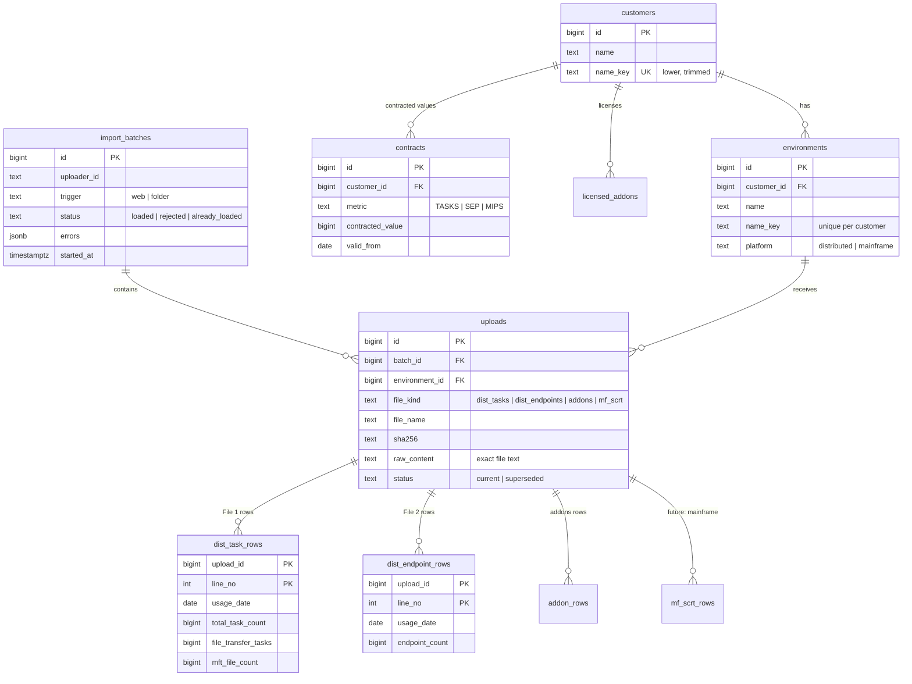

# 04 — Data model (Supabase Postgres, schema `ctm`)

## Database choice: PostgreSQL (on Supabase) instead of MySQL

The brief accepts MySQL but invites a better alternative if we can justify it. MySQL 8 *could* do this job, since it has window functions too. We chose Postgres for reasons that matter to **this** brief:

| Need in the brief | Why Postgres fits better |
|---|---|
| A safe agent that queries stored data (R11) | Tools are **SQL functions** (`SECURITY DEFINER`, fixed `search_path`), which a read-only role can execute. The agent never writes free SQL. MySQL stored routines are weaker for this pattern. |
| One file set = all or nothing | Transactional DDL and functions that run in one transaction, so a failed load leaves no trace. |
| Exact data and audit | `bigint` and `numeric` types store values exactly. Generated columns and partial unique indexes enforce "only one current upload per environment and file type". |
| Hosting with a Vercel app | Supabase provides managed Postgres with connection pooling for serverless functions, backups, and a free tier. With MySQL we would need a separate host. |
| Future mainframe and analytics | `FILTER`, `percentile`, `generate_series` (to find missing days) and JSONB for flexible raw metadata. |

**The trade-off we accept:** Supabase's free projects pause after inactivity, so the demo must be kept awake (see build plan).

## ERD



## Key design decisions

1. **Raw rows keep their line number** (`PK (upload_id, line_no)`). Both duplicate-date rows from `ALL<ENV>.csv` are stored exactly. Combining happens in views, never at import time. This is "store exactly, compute later".
2. **The exact original file text** is kept in `uploads.raw_content` (files are about 10 KB). It's stored in the same transaction, so we can always prove what was received. (Supabase Storage is an option later for large mainframe files.)
3. **Idempotency:** `unique (environment_id, file_kind, sha256)` means the same file uploaded again is detected and nothing changes.
4. **Supersede, don't delete:** a partial unique index `unique (environment_id, file_kind) where status = 'current'` allows exactly one current file per environment and file type. Older uploads stay for audit.
5. **Built to grow:** the upload is *per file* (`uploads`), grouped by `import_batches`. Multi-file upload means more uploads per batch. Folder import means `trigger = 'folder'`. Mainframe means a new `file_kind` plus the `mf_scrt_rows` table plus one more `UNION` branch in `v_env_daily_usage`. **None of these needs a rewrite.**
6. **One long-format view** `v_env_daily_usage (customer_id, environment_id, usage_date, metric, value)` turns every source into the same shape. Reports and the agent read only from this view, so they don't care whether data came from distributed or mainframe files.

## The core SQL (combine, then rank)

```sql
-- 1. Per environment, per day, per metric (from current uploads only)
create view ctm.v_env_daily_usage with (security_invoker = true) as
select e.customer_id, u.environment_id, t.usage_date, m.metric, m.value
from ctm.dist_task_rows t
join ctm.uploads u on u.id = t.upload_id and u.status = 'current'
join ctm.environments e on e.id = u.environment_id
cross join lateral (values
  ('TASKS',     t.total_task_count),
  ('FT_TASKS',  t.file_transfer_tasks),   -- add-on: MFT jobs
  ('MFT_FILES', t.mft_file_count)         -- add-on: files transferred
) as m(metric, value)
union all
select e.customer_id, u.environment_id, r.usage_date, 'SEP', sum(r.endpoint_count)  -- duplicate date rows summed (A5)
from ctm.dist_endpoint_rows r
join ctm.uploads u on u.id = r.upload_id and u.status = 'current'
join ctm.environments e on e.id = u.environment_id
group by e.customer_id, u.environment_id, r.usage_date;
-- future: union all ... from ctm.mf_scrt_rows ... 'MIPS'

-- 2. Combine environments per day FIRST (rule R2)
create view ctm.v_customer_daily_usage with (security_invoker = true) as
select customer_id, usage_date, metric,
       sum(value)                      as value,
       count(distinct environment_id)  as env_count
from ctm.v_env_daily_usage
group by customer_id, usage_date, metric;

-- 3. THEN rank and take the 4th highest (rule R4, ties = separate days, A6)
create function ctm.compliance_summary(p_customer_id bigint, p_from date default null, p_to date default null)
returns table (metric text, days_with_data int, peak bigint, peak_date date,
               fourth_highest bigint, fourth_date date, contracted bigint,
               headroom bigint, status text)
language sql stable security definer set search_path = '' as $$
  with bounds as (
    select coalesce(p_to, max(usage_date)) as t
    from ctm.v_customer_daily_usage where customer_id = p_customer_id
  ), win as (
    select coalesce(p_from, t - 364) as f, t from bounds
  ), ranked as (
    select d.metric, d.usage_date, d.value,
           row_number() over (partition by d.metric order by d.value desc, d.usage_date) as rn,
           count(*)     over (partition by d.metric) as n
    from ctm.v_customer_daily_usage d, win
    where d.customer_id = p_customer_id and d.usage_date between win.f and win.t
  ), agg as (
    select metric, max(n)::int as n,
           max(value)      filter (where rn = 1) as peak,
           min(usage_date) filter (where rn = 1) as peak_date,
           max(value)      filter (where rn = 4) as fourth,
           min(usage_date) filter (where rn = 4) as fourth_date
    from ranked group by metric
  )
  select a.metric, a.n, a.peak, a.peak_date, a.fourth, a.fourth_date,
         c.contracted_value,
         c.contracted_value - a.fourth,
         case when a.n < 4 then 'not_enough_data'
              when c.contracted_value is null then 'no_contract'
              when a.fourth > c.contracted_value then 'over_contract'
              else 'within_contract' end
  from agg a
  left join lateral (
    select contracted_value from ctm.contracts c, win
    where c.customer_id = p_customer_id and c.metric = a.metric and c.valid_from <= win.t
    order by c.valid_from desc limit 1
  ) c on true;
$$;
```

**Test it against the known answers:** BANK → SEP 348, TASKS 121,970. DCS → SEP 181, TASKS 11,571 (`01_data_profile.md`).

## Write and read functions

| Function | Role allowed | Purpose |
|---|---|---|
| `ctm.load_file_set(jsonb)` | `ctm_loader` | One transaction: find or create the customer and environment, check checksums (`already_loaded`), insert uploads and rows, supersede old uploads, log the batch. |
| `ctm.log_rejected_batch(jsonb)` | `ctm_loader` | Records a refused upload with its error list (so failures are visible too). |
| `ctm.upsert_contract(...)`, `ctm.set_licensed_addons(...)` | `ctm_loader` | Contract screen. |
| `ctm.compliance_summary(...)` | `ctm_reader` | Report header and agent tool. |
| `ctm.daily_series(customer, metric, from, to, by_env bool)` | `ctm_reader` | Chart data and agent tool. |
| `ctm.top_days(customer, metric, n, from, to)` | `ctm_reader` | Peak days. |
| `ctm.monthly_trend(customer, metric)` | `ctm_reader` | 12-month trend (max and average per month). |
| `ctm.addon_usage(customer)` | `ctm_reader` | Licensed vs installed vs used. |
| `ctm.coverage(customer)` | `ctm_reader` | Date range per environment and missing days (`generate_series`). |
| `ctm.list_customers()` | `ctm_reader` | For the agent to resolve names. |

## Least privilege (carried over from Haibot)

- The `ctm` schema is **not** exposed via the Supabase REST API.
- `ctm_loader`: **EXECUTE** only on the write functions. It has no direct table access.
- `ctm_reader`: **EXECUTE** on the read functions only, with `default_transaction_read_only = on` and `statement_timeout = '10s'`. The agent connects as this role.
- `REVOKE ALL ... FROM PUBLIC`. Every function uses `set search_path = ''`.

## Migrations (`db/migrations/`)

`001_schema.sql`, `002_views.sql`, `003_load_functions.sql`, `004_read_functions.sql`, `005_roles.sql`, `006_seed_addon_products.sql`.
