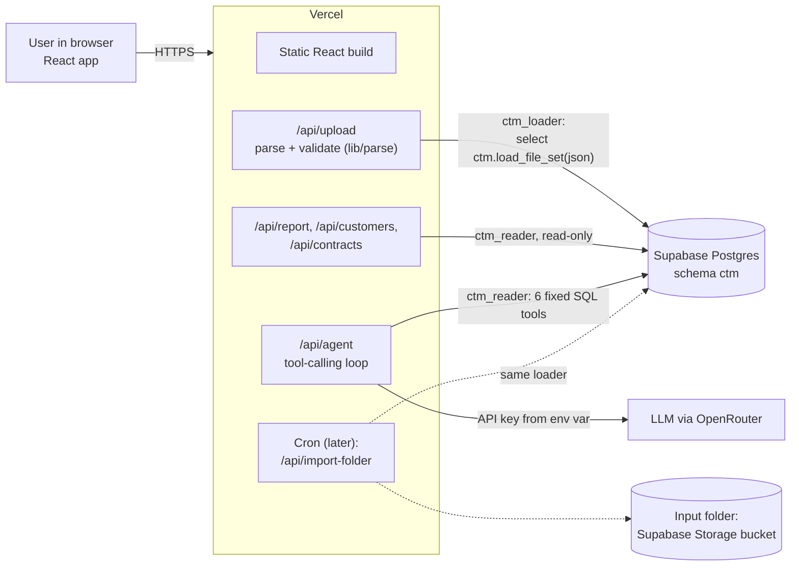

# 05 — Solution design

## What replaced n8n

In Haibot, n8n held three workflows: ingestion, the Dashboard API and the chat agent. Here each one becomes a **Vercel serverless function**: a small piece of server code that runs only when it's called.

| Haibot (n8n) | Control-M (no n8n) |
|---|---|
| Schedule trigger + ingestion workflow | `POST /api/upload` (user-triggered). Later, a **Vercel Cron** job runs the same loader over a folder. |
| Dashboard API webhook | `GET /api/report`, `GET /api/customers` |
| AI Agent node + Postgres tools | `POST /api/agent`: our own tool-calling loop (about 100 lines of TypeScript) calling SQL functions |
| n8n credentials | Vercel environment variables (server-only) |

Writing the agent loop ourselves is a **plus** for an engineering assessment. It shows we understand what the n8n AI Agent node does under the hood.

## Architecture

## Request flows

**Upload (Phase 1):**

1. The form collects Uploader ID, Customer and Environment, then File 1 and File 2 (plus the optional add-ons file).
2. The browser sends multipart data to `/api/upload`.
3. `lib/parse` validates it (`03_import_rules.md`).
4. On any error, `log_rejected_batch` runs and the API returns `422` with the error list.
5. Otherwise `load_file_set` runs in one transaction and returns `loaded` or `already_loaded`, with row counts.

**Report:** `/api/report?customer=..&from=..&to=..` calls `compliance_summary`, `daily_series`, `addon_usage` and `coverage`, then returns one JSON bundle. The page and the agent use the **same SQL**, so their numbers always agree.

**Agent:** `/api/agent` takes `{ message, customerId?, history }`. It loops up to 6 times: the LLM picks a tool, the server runs that SQL function as `ctm_reader`, and the result goes back to the LLM. The final answer is returned with the list of tools used, which is shown in the UI for transparency. Details are in `06_agent_design.md`.

## How "built to grow" works (slide 6)

| Later phase | What changes | What doesn't |
|---|---|---|
| Multi-file upload | The UI accepts several environment pairs, and the API loops over `load_file_set` once per pair. Each pair is still atomic, so one bad pair doesn't block the others. | Parser, schema, report |
| Auto import from a folder | A Vercel Cron job (for example daily at 04:00 SAST) lists the files in a Supabase Storage bucket `incoming/`, pairs them by environment, runs the same parser and loader, then moves them to `processed/` or `rejected/`. | Parser, schema, report |
| Mainframe SCRT | New parser `lib/parse/scrt.ts`, `file_kind = 'mf_scrt'`, table `mf_scrt_rows`, and one more `UNION ALL` branch producing `MIPS`. | Report, agent, UI |
| Automated contracts | A contract import replaces the manual form, writing to the same `contracts` table. | Everything else |

## Handling missing, wrong and repeated files

| Situation | Behaviour |
|---|---|
| File named for the wrong environment | Rejected before storage (`env_mismatch`) |
| Only one of the two files | Rejected (`missing_file`) |
| Same file uploaded twice | `already_loaded`, nothing changes |
| Corrected file for the same environment | New upload becomes current, the old one is kept as `superseded` |
| One environment covers fewer days | Report shows a **coverage** warning. Totals use the environments present (A8). |
| Database down or timeout | API returns 503 or 504 with a friendly message. The upload can be retried safely because loads are idempotent. |

## Security

- **Secrets live only in Vercel environment variables:** `DATABASE_URL_LOADER`, `DATABASE_URL_READER` and `OPENROUTER_API_KEY`. The browser never sees them.
- API routes validate their input:
  - file size of 2 MB or less;
  - agent message of 500 characters or less;
  - ISO dates.
- Each instance rate-limits the agent to 10 requests per minute per IP. Timeouts apply: 10 s for the database, 30 s for the LLM.
- Security headers and a strict Content-Security-Policy are set in `vercel.json`.
- Two database roles (loader and reader). The agent can't write, even if it's prompt-injected.
- **Known gap:** there is no sign-in in Phase 1 (A15). Usage data is commercially sensitive, so Vercel password protection or Supabase Auth is next step #1.

## Serverless gotcha to plan for

Use Supabase's **transaction pooler (port 6543)** from Vercel functions. Serverless functions open many short connections. Use the `postgres` npm package with `prepare: false`, because the transaction pooler doesn't support prepared statements. The username format is `role.projectref`, the same as in Haibot.
